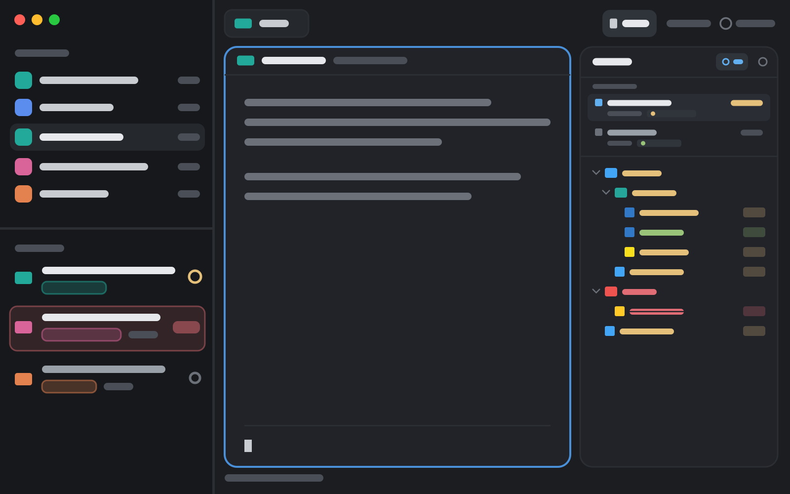

# cscode

A layout for the [Herdr](https://herdr.dev) desktop app that gives your agents a
code-editor feel: a VS Code-style file explorer with git colours and per-worktree
changes, single-click preview tabs, and an agent-kept to-do list, next to your
spaces, agents and framed panes.



## What's in it

- **Files**: Material file icons; every changed file and folder in its git colour
  with a badge (added, modified, deleted, conflict); a **changed only** view that
  keeps the folder structure, shows deleted files, and lists the repo's
  **worktrees** with the agents working in each. Click a worktree to see what
  changed there.
- **Preview tabs**: a single click opens a file in the space's preview tab and the
  next click replaces it; a double click (or an edit) keeps it in a tab of its own.
  Files open in an editor with save, preview and syntax colours.
- **To-do**: per-project lists your agents keep for you (from Over9k), with
  markdown and multi-line items.
- **Changes**: Herdr's own diff panel.
- Spaces and agents in the sidebar, tabs as pills, every pane a card with a header.

See [`cscode/RECIPE.md`](cscode/RECIPE.md) for every detail.

## Install

Ask your agent in Herdr:

```text
Read ~/.config/herdr-app/AGENTS.md, then add this layout: https://github.com/csavur/herdr-cscode/tree/main/cscode
```

Or by hand:

```sh
git clone https://github.com/csavur/herdr-cscode
cd herdr-cscode/cscode
cp layouts/cscode.json layouts/cscode.svg ~/.config/herdr-app/layouts/
cp -R mods/* ~/.config/herdr-app/mods/
# merge keys.json's "mod:cscode-viewer" section into ~/.config/herdr-app/keys.json
herdr-app do layout.switch '{"name":"cscode"}'
```

`ctrl-shift-l` switches back to your own layout; deleting the files removes it.

## What it runs

- **Files**: `sh` and `git` (listing folders, `git status`, `git worktree list`),
  `open` / `xdg-open` for "Open with default app". It reads agents' screens
  (`hc read`) to tell which worktree each one works in. It writes only when you
  save a file in the viewer.
- **To-do**: `sh`, `git`, `python3`; `hc send` to hand a to-do to an agent.
  Its **Set up** button (only when you click it) writes a rule into
  `~/.claude/CLAUDE.md` (and Codex's and Pi's `AGENTS.md`), adds a Claude Code
  hook, and installs `~/.local/bin/todo`. Undo with
  `sh ~/.config/herdr-app/mods/cscode-todo/setup.sh todo off ~/.config/herdr-app/mods`.
- No network access.

## Credits and licences

cscode is Apache-2.0 ([LICENSE](LICENSE)). It builds on:

| Part | From | Licence |
|---|---|---|
| `cscode-spaces`, `-agents`, `-tabs`, `-pane`, `-files` | Herdr's own mods, [herdrdev/herdr-app](https://github.com/herdrdev/herdr-app) | Apache-2.0 |
| `cscode-files`, `cscode-viewer`, `cscode-file-menu` | [mchlkim/herdr-file-explorer](https://github.com/mchlkim/herdr-file-explorer) | MIT |
| File icons (`cscode-files/icons`, `icons.js`, `lookup.js`) | [LaiqianDS/herdr-mods](https://github.com/LaiqianDS/herdr-mods) `file-icons`, icons from [Material Icon Theme](https://github.com/material-extensions/vscode-material-icon-theme) | Apache-2.0, MIT |
| `cscode-todo` | [herunan/herdr-over9k](https://github.com/herunan/herdr-over9k) | MIT |

Each mod folder carries the licence texts of what it came from. All of them were
changed for cscode.
