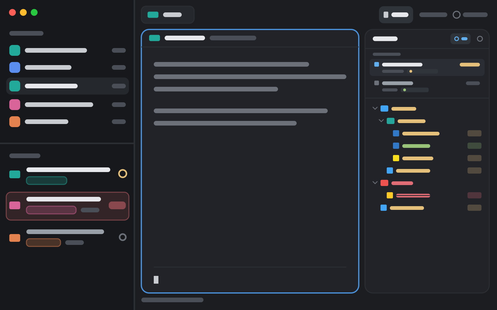

# cscode

A code-editor feel next to your agents. Spaces and agents on the left, the
active tab's panes as framed cards in the middle, and a right panel with a
VS Code-style file explorer: Material file icons, git colours on every changed
file and folder, a "changed only" view that also shows each git worktree and
the agent working in it, and files that open in a preview tab with a single
click. The same panel holds Changes and an agent-kept To-do list.

## What you see

Left to right. Colours are theme names; the layout sets no theme of its own.

- **Sidebar**, 268px (44 to 480), on `chrome`, not resizable by drag:
  - **Brand row**, 46px, Herdr's `workspace-chrome` (window drag area; the
    macOS traffic lights sit at 12, 16).
  - **Spaces** (`cscode-spaces`) over **Agents** (`cscode-agents`), equal
    weight, each at least 90px.
  - **Footer**, 69px, `workspace-chrome` with `{ "footer": true }`.
- **Work column**:
  - **Tab bar**, 42px (`cscode-tabs`, window drag area): tabs as 29px pills
    (the active one on `raised` with a `border`), each with its program's icon,
    a spinner while its agent works, and a status dot when it's blocked or done.
    Then `+` (the new-menu), and the panel buttons **Files**, **Changes**,
    **To-do**, the open one on `selected`. A file's preview tab is in italics.
  - **Body**, padding 8, gap 8: the active tab's panes, each a card on
    `background` with a 1px `border` (focused: `accent`), radius 10, gap 8,
    framed even when alone, with a 30px header on top (`cscode-pane`: program
    icon, agent name or title, folder, status, split / zoom / close buttons).
  - **Right panel**, 368px (280 to 900), hidden until a panel button opens it:
    a stack of **Files** (`cscode-files`), **Changes** (Herdr's `changes`) and
    **To-do** (`cscode-todo`), each a card on `background`, radius 10.
  - **Status bar**, 28px, Herdr's `workspace-status`.

### The Files panel

- **Header**, 42px: "Files", the folder shown (dim, right-aligned), the
  **changed only** button (`git-branch` icon; on: shaded `selected`, icon and
  the count of changed files in `accent`), and the **eye** (hide dotfiles).
- **Rows**, 24px, indented 18px per level: chevron (folders), the Material Icon
  Theme icon for the file or folder (folders have open and closed icons), the
  name, and on the right the git mark.
- **Git colours**, from the theme's terminal colours: added or new `ansi2`
  (green), modified `ansi3` (yellow), deleted `ansi1` (red), conflict `ansi5`
  (magenta). A changed file's name takes its colour, with a badge on the right:
  its icon (`plus`, `square-pen`, `minus`, `git-compare`) and letter, on the
  colour at 14% alpha. A folder with changes inside takes the colour of the
  most serious one (conflict > deleted > modified > added) and shows its icon.
- **Changed only**: a tree of the changed paths alone, folders open, built from
  `git status`, deleted files included (struck through). In a repo with more
  than one worktree, a **Worktrees** list sits above it (at most 220px): each
  worktree's folder ("main checkout" on the first), its branch, "N changed" in
  `ansi3` or "clean", and a chip per agent working in it (status dot and
  name). The one shown is shaded.

### The To-do panel

Over9k's to-do panel (see its own recipe at
github.com/herunan/herdr-over9k, `over9k-todo`), with a multi-line input:
"Add a to-do: markdown, #project, @when", 2 to 10 lines, then a hint line and
an **Add ⌘↵** button. Open to-dos render as markdown: the first line until
hovered (with a `+N` badge for more lines), all of it on hover.

## How it behaves

- **Agent status** shows in the agents list, the tab pills (spinner while
  `working`, a `blocked` / `done` dot) and the pane header; `idle` shows nothing.
- **Files**: the tree follows the focused terminal's folder (a file tab shows
  the folder it was opened from). A click opens a file in this space's
  **preview tab**: the next single click shows its file there instead. A double
  click keeps the file in a tab of its own; editing a previewed file keeps it
  too. A file already in a tab of its own just shows that tab. Cmd-click opens
  it in the default app; right-click opens a menu (Open, Open with default app,
  Reveal in Finder, copy path / relative path / name, New terminal here).
  Deleted files can't open (a toast says so).
- **The file viewer** (`cscode-viewer`, a pane mod in its own tab): edit and
  save (Cmd-S), Ctrl-W closes (asks about unsaved changes), Cmd-Shift-V
  switches between the editor and a preview (markdown rendered, other formats
  coloured). A remote file is read-only.
- **Worktrees** (changed only): a click on one shows its changes and its files
  open from there; the one the pane is in goes back to following the pane. A
  click on an agent chip runs `agent.focus`. An agent belongs to the worktree
  its last 400 lines of output name last (path or folder name), else the one
  its terminal is in; agents outside the repo are left out. Read every 10s.
- **Panels** are remembered per space: switching spaces shows that space's
  panel, or none.
- **To-do**: as Over9k's. Enter types a line break, Cmd/Ctrl-Enter or Add adds,
  Enter takes a `#` / `@` suggestion; Cmd/Ctrl-Enter or leaving saves an edit.
  Line breaks are stored as ` ` in the list file.

## Built from

- `layouts/cscode.json`: root `row` (`titlebar: none`, `traffic_lights: [12, 16]`,
  `background: canvas`, `terminal_padding: [14, 12]`, 1px `border` divider):
  `sidebar` column (`brand`, `sidebar-lists` column with `spaces` and `agents`,
  `sidebar-footer`) and `work` column (`tabs`, `work-body` row with `main`
  (`{ "tab": "active" }` with the pane frame above) and `panel` column holding
  the `panel-body` stack of `files`, `changes`, `todos`), then `status`.
  `layouts/cscode.svg` is its picture in Settings.
- Mods, each its own folder under `mods/`:
  - `cscode-spaces`, `cscode-agents`, `cscode-tabs`, `cscode-pane`: Herdr's
    `spaces`, `agents`, `tabs`, `pane`, reworked (shared `space.colors` gives
    each space a colour every one of them uses).
  - `cscode-files`: Herdr's `files` by way of mchlkim/herdr-file-explorer,
    with git colours, changed only, worktrees and preview tabs; `lookup.js` +
    `icons.js` + `icons/` are the Material Icon Theme set from
    LaiqianDS/herdr-mods `file-icons`.
  - `cscode-viewer`, `cscode-file-menu`: from mchlkim/herdr-file-explorer;
    the viewer gained preview tabs.
  - `cscode-todo`: from herunan/herdr-over9k, with markdown and the larger input.
- Shared state between them: `cscode-viewer:open` (file -> tab),
  `cscode-viewer:preview` (space -> preview tab), `cscode-viewer:show` (a file
  for a preview tab), `cscode-files:menu` (the menu's choice).
- `herdr`: `run` (`tab.new` with `mod`, `tab.select`, `tab.rename`,
  `layout.select` / `show` / `hide`, `agent.focus`, ...), `exec` (`sh`, `git`,
  `open`), `hc` (`read`, `send`), `watchFolder`, `readTextFile`,
  `writeTextFile`, `agents`, `panes`, `spaces`, `shared` / `setShared`.
- Programs: `git`, `sh`; for the To-do panel also `python3` and `jq`.
- `keys.json`: the viewer's keys, in a `mod:cscode-viewer` section.

## Watch out

- The viewer's keys (Cmd-S, Cmd-Shift-V, Ctrl-W) must stay unbound globally:
  a `mod:` key doesn't stop a global binding on the same key.
- Worktree-to-agent matching reads agents' screens (`hc read`): an agent that
  never prints the worktree's path or folder name counts for the worktree its
  terminal is in.
- Changed only lists every new file (`--untracked-files=all`); the tree stops
  at 5,000 entries. A remote space is polled every 10s instead of watched.
- The To-do panel's **Set up** writes a rule into `~/.claude/CLAUDE.md` (and
  Codex's and Pi's `AGENTS.md`), adds a `UserPromptSubmit` hook to
  `~/.claude/settings.json` and installs `~/.local/bin/todo`;
  `sh mods/cscode-todo/setup.sh todo off <mods folder>` takes them out.
- `cscode-files/icons/` is 1,184 SVGs (about 860 KB).
- Rename a mod and you must rename its `mods/<name>/` asset paths, its
  `openOverlay` / `tab.new` mod names and the shared keys above.

## Done when

- `layout.switch {"name": "cscode"}` shows the sidebar, the tab bar with Files,
  Changes and To-do, and framed panes with headers.
- In a git repo with an edited file, Files shows the file's name in yellow with
  an `M` badge and its folders yellow with the pencil icon.
- Changed only shows just the changed paths; with a second worktree, the
  Worktrees list shows both, and clicking the second shows its changes.
- A single click on two files in turn shows both in one italic preview tab; a
  double click opens a tab that a later single click leaves alone.
- To-do: Cmd-Enter adds a multi-line to-do; its bold and code render as markdown.
- `herdr-app check` passes for every folder in `mods/`.
